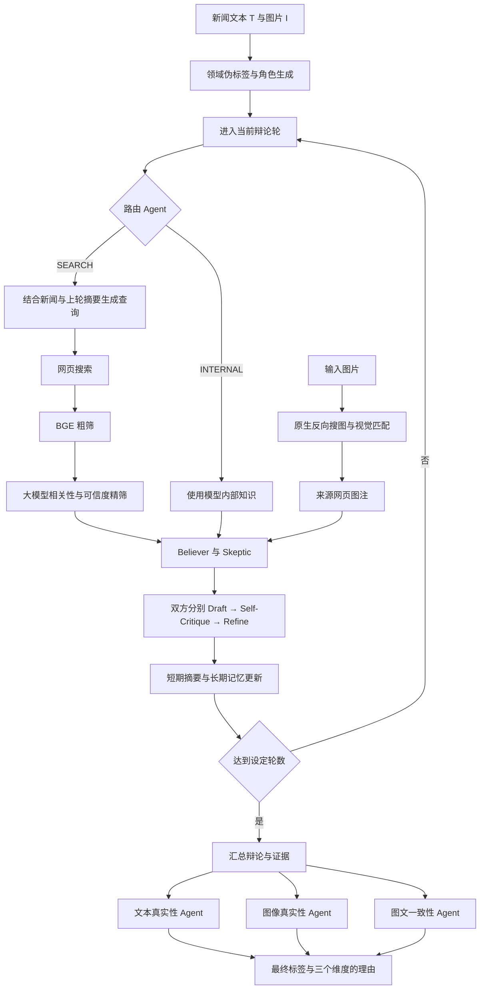
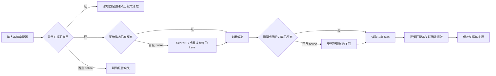

# MAR_SearXNG：基于 SearXNG、持久证据缓存与本地 Qwen3.8 的 MAR

本项目在论文 **MAR: Metacognitive Agentic Reasoning for Multimodal Fake News Detection** 的代码基础上，保留领域角色、元认知辩论和多维裁决流程，接入本地 Qwen3.8-27B FP8、自部署 SearXNG、SQLite 检索缓存，以及可断点继续的批量实验与中文报告。

给定一段新闻文本和一张图片，系统分别判断文本真实性、图像真实性和图文一致性，最终输出四分类标签及判断理由。本目录目前用于两套作者公开测试集各 1,000 条、共 2,000 条的推理评估，**没有进行模型训练或微调**。

> 本文于 **2026-10-21** 根据本地论文、当前源码、服务检查和实验文件重写。运行状态会变化，文中的数量均有对应时间或来源。当前属于**更换模型与检索后端的 MAR 实验变体**，完整准确率提升尚未得到验证。

## 目录

- [0. GitHub 版本与大文件下载恢复](#0-github-版本与大文件下载恢复)
- [1. 项目现在做到哪里](#1-项目现在做到哪里)
- [2. 这台服务器的硬件与软件环境](#2-这台服务器的硬件与软件环境)
- [3. 原论文的目标与整体框架](#3-原论文的目标与整体框架)
- [4. 当前项目已经完成的改动](#4-当前项目已经完成的改动)
- [5. 目录结构与原项目依赖](#5-目录结构与原项目依赖)
- [6. 数据、标签与证据状态](#6-数据标签与证据状态)
- [7. 环境配置与迁移准备](#7-环境配置与迁移准备)
- [8. 在当前服务器上快速运行](#8-在当前服务器上快速运行)
- [9. 检索缓存与图像证据准备](#9-检索缓存与图像证据准备)
- [10. 单条、小批与全量实验](#10-单条小批与全量实验)
- [11. 结果文件与评估口径](#11-结果文件与评估口径)
- [12. 离线复用与可追溯性验证](#12-离线复用与可追溯性验证)
- [13. 性能记录与资源使用](#13-性能记录与资源使用)
- [14. 常见问题与排查](#14-常见问题与排查)
- [15. 已知限制与后续工作](#15-已知限制与后续工作)
- [16. 论文、代码与技术资料](#16-论文代码与技术资料)

## 0. GitHub 版本与大文件下载恢复

仓库地址：**https://github.com/Charliserein/MAR_SearXNG**。

GitHub 版本包含全部业务源码、测试、部署脚本、依赖清单、SearXNG 配置模板、论文 PDF，以及两套作者测试集的来源清单和固定样本索引。模型、Python 环境、图片、新闻内容、图注、检索缓存和实验输出按下表另行恢复，避免将本机运行目录直接塞进 Git。

### 0.1 哪些内容没有上传，以及如何取得

| 未上传内容 | 当前规模 / 原因 | 下载或恢复方式 | 目标位置 |
|---|---|---|---|
| Qwen3.8-27B FP8 权重 | 约 30.89 GB，单个权重分片较大 | 本仓库 `scripts/download_model.py`，固定 revision 并核对哈希 | `models/Qwen3.8-27B-FP8/` |
| `.venv` / `.venv-vllm` | 本机推理环境约 8 GiB，环境不可直接跨机器复用 | 按锁定依赖重新安装 | 根目录两个虚拟环境 |
| BGE embedding 权重 | 预训练模型文件 | 从官方 `BAAI/bge-base-en-v1.5` 下载 | `models/bge-base-en-v1.5/` |
| FastText `lid.176.bin` | 官方标注约 126 MB；旧语言识别提取链路使用 | 从 FastText 官方下载 | `models/lid.176.bin` |
| DGM4 图片 | 选定图片来自八个官方 ZIP，完整下载会占用数 GB | 从固定版本的 DGM4 官方数据下载 ZIP，再按样本索引提取 | `downloads/` → `data/*/images/` |
| MMFakeBench 图片 | 使用 `MMFakeBench_val.zip`，646,404,567 字节 | 先按官方要求取得访问权限，再下载固定版本 | `downloads/MMFakeBench_val.zip` |
| 新闻文本与作者图注 | 从作者已公开的固定代码版本恢复，避免重复发布数据内容 | `python3 scripts/download_metadata.py`，校验原作者文件 SHA-256 | `data/*/samples.json` 与初始证据清单 |
| 本机新增图注与检索缓存 | 缓存和网页内容随时间变化，不属于原始作者数据 | `prepare`、`warm` 和实际 MAR 运行生成 | `cache/`、`data/*/reverse-evidence.json` |
| 当前实验记录与报告 | 持续写入的本机输出，不作为静态源码提交 | 重跑评估与 `run.sh report` 生成 | `outputs/` |
| `.env`、实例密钥 | 包含本机配置或私人凭据 | 按模板本地创建；实例密钥由启动脚本生成 | `.env`、`deploy/searxng/instance.env` |

发布文件中没有模型分片、数据图片或 Python 环境，也没有 Git LFS 占位文件。下载资源会消耗额外磁盘空间；完整 ZIP 与提取后的图片可能同时存在。

### 0.2 克隆并安装依赖

以下命令用于**新的克隆副本**。当前服务器正在运行的目录不需要重复执行安装或原地恢复步骤。

```bash
git clone https://github.com/Charliserein/MAR_SearXNG.git
cd MAR_SearXNG

python3.12 -m venv .venv
.venv/bin/python -m pip install --upgrade pip
.venv/bin/python -m pip install --index-url https://download.pytorch.org/whl/cpu torch==2.8.0
.venv/bin/python -m pip install -r requirements.lock.txt

python3.12 -m venv .venv-vllm
.venv-vllm/bin/python -m pip install --no-cache-dir -r deploy/qwen/requirements.lock.txt
```

主机还需要 NVIDIA 驱动，以及 Docker Engine 和 Docker Compose v2。GPU 环境按当前已验证的软件版本锁定；CPU 流程不依赖 GPU PyTorch。

### 0.3 下载模型文件

```bash
# 固定版本的主模型，下载断点直接保存在目标目录。
python3 scripts/download_model.py --workers 6
python3 scripts/download_model.py --verify-only

# 官方 BGE 权重；本次发布查询得到的固定 revision。
.venv/bin/hf download BAAI/bge-base-en-v1.5 \
  --revision a5beb1e3e68b9ab74eb54cfd186867f64f240e1a \
  --local-dir models/bge-base-en-v1.5

# 旧图注提取工具涉及语言识别时使用的 FastText 文件。
mkdir -p models
curl -fL --retry 3 \
  https://dl.fbaipublicfiles.com/fasttext/supervised-models/lid.176.bin \
  -o models/lid.176.bin
```

主模型来源与固定哈希校验机制见第 7.5 节；BGE 来源为[官方模型页](https://huggingface.co/BAAI/bge-base-en-v1.5)，FastText 文件来源为[官方语言识别页面](https://fasttext.cc/docs/en/language-identification.html)。下载并不意味着模型文件已经纳入 Git。

### 0.4 恢复两套固定样本的文本和作者图注

```bash
python3 scripts/download_metadata.py
```

该脚本从 MAR 作者代码固定版本 `3bb8c69e437d1b4a5a31d412210f0de3b2003847` 下载两份原始作者测试文件，核对以下 SHA-256，并按仓库中的 `sample-index.json` 恢复当前使用的 1,000 + 1,000 条选择：

| 作者文件 | SHA-256 |
|---|---|
| `data_processing/DGM4/test_final.json` | `5644105fb9334bd072e4a7a7c5a8bd9cebff1c62c1865a64495b3f939b6a5b01` |
| `data_processing/MMFakeBench/test_set.json` | `fefcea882fb1ddd3e97282880a191c83037fc32aa7475dfa9d92926ffd353595` |

脚本不会覆盖已有 `samples.json` 或 `reverse-evidence.json`。首次恢复只包含作者公开图注：DGM4 为 212 条、MMFakeBench 为 146 条，共 358 条。本文后续提到的 385 条有图注是当前服务器历史准备结果，还包含 27 条本机取得的新增证据；新克隆副本不会自动拥有这些缓存。

恢复阶段不会下载图片，必须继续执行下面的图片准备步骤后才能评估。

### 0.5 下载 DGM4 官方图片压缩包

本项目固定使用 [rshaojimmy/DGM4 的版本 `9efd3f1`](https://huggingface.co/datasets/rshaojimmy/DGM4/tree/9efd3f1ca14cb1dac1692cdce0beea6844b968a6)。下载以下八个压缩包：

```bash
.venv/bin/hf download rshaojimmy/DGM4 \
  origin/bbc.zip origin/guardian.zip origin/usa_today.zip origin/washington_post.zip \
  manipulation/HFGI.zip manipulation/StyleCLIP.zip \
  manipulation/infoswap.zip manipulation/simswap.zip \
  --repo-type dataset \
  --revision 9efd3f1ca14cb1dac1692cdce0beea6844b968a6 \
  --local-dir downloads
```

下载完成后目录应包括 `downloads/origin/*.zip` 和 `downloads/manipulation/*.zip`。恢复脚本只提取清单所需图片，不需要解压所有原始图片。

### 0.6 下载 MMFakeBench 官方图片

[MMFakeBench 官方数据页](https://huggingface.co/datasets/liuxuannan/MMFakeBench)要求先在网页上按其数据使用流程取得访问权限。之后在本机登录自己的 Hugging Face 账号；不要将令牌写进 Git：

```bash
.venv/bin/hf auth login
.venv/bin/hf download liuxuannan/MMFakeBench MMFakeBench_val.zip \
  --repo-type dataset \
  --revision b63091556dc85069533f96d914277b7402dcd5a3 \
  --local-dir downloads
```

所需文件为 **val 压缩包**，不是容量更大的 test 压缩包。当前作者样本来自该压缩包，已记录文件大小 646,404,567 字节，SHA-256：

```text
e93a07c6a941b7f1695e1d06cd2f6daa9fa73ff9743f1e5054d12325803f061b
```

可用下面的命令核对：

```bash
sha256sum downloads/MMFakeBench_val.zip
```

如果提示 401/403，应检查官方访问权限和本机 Hugging Face 登录状态；本仓库没有提供绕过官方数据访问流程的镜像。

### 0.7 提取图片并修复新副本的绝对路径

在新副本中，元数据和 ZIP 都准备好后执行：

```bash
# 默认写入 data-local/，保留原清单，便于先检查恢复结果。
.venv/bin/python scripts/restore_data.py --archives-root downloads

# 确认后，仅在没有运行实验的新副本中，将路径写回默认 data/。
# experiment / prepare 等默认入口使用 data/，因此新副本通常需要这一步。
.venv/bin/python scripts/restore_data.py --archives-root downloads --in-place
```

恢复脚本根据每条索引中的 `archive` 和 `zip_member` 读取图片，逐张验证 `image_sha256`，不重新抽样、不改变标签。图片全部成功后，再更新目标 `samples.json`、`manifest.json` 和图像证据清单的输入哈希。断点重跑会复用已验证图片；图片哈希不匹配时明确失败。

两个默认输出的图片路径分别是 `data/DGM4-author1000/images/` 和 `data/MMFakeBench-author1000/images/`。如果只想恢复单套，可加 `--dataset DGM4-author1000` 或 `--dataset MMFakeBench-author1000`。

当前服务器已有原图片时，也可使用 `--reuse-existing`，先将有效图片复制到独立 `data-local/`，避免重新下载 ZIP；默认仍不会改写旧输入。已启动或已有冻结实验的目录不要执行 `--in-place`。

### 0.8 创建适合新副本的配置

模板保留了原服务器示例路径，下面的命令会在**文件尚不存在时**生成指向当前克隆目录的 `.env`，并创建不含私有代理的搜索配置：

```bash
python3 - <<'PY'
from pathlib import Path
root = Path.cwd().resolve()
environment = root / '.env'
if not environment.exists():
    content = (root / '.env.example').read_text()
    replacements = {
        'MAR_EMBEDDING_MODEL': str(root / 'models/bge-base-en-v1.5'),
        'MAR_FASTTEXT_MODEL': str(root / 'models/lid.176.bin'),
        'MAR_CACHE_DB': str(root / 'cache/evidence.sqlite3'),
        'MAR_HTTP_PROXY': '',
    }
    lines = []
    for line in content.splitlines():
        key = line.split('=', 1)[0]
        lines.append(key + '=' + replacements[key] if key in replacements else line)
    with environment.open('x') as stream:
        stream.write('\n'.join(lines) + '\n')
    environment.chmod(0o600)
settings = root / 'deploy/searxng/settings.yml'
if not settings.exists():
    with settings.open('x') as stream:
        stream.write((root / 'deploy/searxng/settings.example.yml').read_text())
PY
```

需要上游代理时自行修改新副本的 `.env` 与 `deploy/searxng/settings.yml`。模型和搜索服务默认绑定本机回环地址。

### 0.9 启动、验收和第一条评估

```bash
./run.sh searxng up
./run.sh model
./run.sh status

# 等模型日志显示加载完成且 /v1/models 正常后，再运行真实请求。
./run.sh search "NASA Artemis I launch November 16 2022"
./run.sh evaluate \
  --input data/DGM4-author1000/samples.json \
  --output outputs/clone-pilot \
  --rounds 3 --workers 1 --max-new 1 \
  --no-strict-evidence --strict-web
./run.sh report outputs/clone-pilot
```

克隆副本不包含本机的动态查询缓存。需要补充图片候选和新图注时继续阅读第 9 节。当前专用于原服务器的 `deploy/qwen/smoke.py` 和并发测速脚本仍包含历史数据绝对路径；在新机器直接使用前先适配其数据路径，通用评估入口 `run.sh evaluate` 已可使用恢复后的输入。

发布前已核对：两套各 1,000 条的元数据恢复结果，其文本、标签、作者图注、图片 SHA-256 和压缩包成员均与当前输入逐条一致。新增恢复工具的校验测试与原有业务测试会一起执行；这不代表尚未下载的官方图片已经在新机器完成下载。

## 1. 项目现在做到哪里

### 1.1 已经可以使用的能力

| 能力 | 当前情况 | 核对入口 |
|---|---|---|
| 本地多模态模型 | Qwen3.8-27B FP8 已部署，支持真实图片请求 | `./run.sh status`、`outputs/model-vision-smoke.json` |
| 模型接口 | OpenAI 兼容接口，模型别名 `Qwen3.8-27B` | `http://127.0.0.1:19888/v1/models` |
| 本地搜索 | SearXNG 网页搜索和文字搜图 | `http://127.0.0.1:18888` |
| 搜索复用 | 同参数查询命中 SQLite 后不再请求搜索后端 | `retrieval/search.py` |
| 图像证据 | 导入作者图注、复用已有原生反搜、文字搜图后做视觉匹配 | `./run.sh prepare` |
| 离线检索 | 只读取已有检索证据，缺失有明确状态 | `MAR_CACHE_MODE=offline` |
| 完整 MAR 推理 | 保留领域角色、三轮辩论、记忆和三维判断 | `MAR_framework/NewsAnalyzer.py` |
| 后台批量实验 | 8 路样本并发、断点续跑、错误重试、冻结配置 | `./run.sh experiment` |
| 结果报告 | JSON、CSV、HTML、中文 Word 报告 | `scripts/report_evaluation.py` |
| 自动检查 | 本次发布检查，77 项测试全部通过 | `tests/` |

### 1.2 当前实验不是“全部成功完成”

读取 `outputs/author2000-qwen38/progress.json` 时，**北京时间 2026-10-21 15:31:49** 的快照如下：

| 项目 | 数量 / 状态 |
|---|---:|
| 目标样本 | 2,000 |
| 已有最新尝试记录 | 2,000 |
| 有效成功预测 `ok` | 559 |
| 最新记录为错误 | 1,441 |
| 尚无尝试记录 `pending` | 0 |
| 仍待重新尝试的错误 | 1,441 |
| 错误类型 | `SearchUnavailable` |
| 后台状态 | `running` |
| 样本并发 / 辩论轮数 | 8 / 3 |

这里的 `completed_records=2000` 代表每条都已有记录，包含失败；`pending=0` 也不代表任务已经成功结束。后续重试可能把错误记录替换为成功记录，报告和进度文件分批刷新，读取时可能相差几条。

`SearchUnavailable` 不仅可能表示搜索后端不可用，也可能来自“要求搜索但没有生成合法查询”或检索相关性评估输出无效。实际原因应检查逐条 `error`、`traceback` 和 `retrieval_diagnostics`，不能仅凭异常类型判断具体故障。

查看此刻的实际状态：

```bash
cd /home/c/czh/MAR_KDD_SearXNG
./run.sh status
./run.sh experiment status
```

### 1.3 当前证据覆盖

以下为本次核对时两份 `reverse-evidence.json` 的汇总：

| 数据集 | 总数 | 作者图注 | 新增有效图注 | 有图注合计 | 已确认无结果 | 已确认无图注 | 状态已准备 `ready` | 待准备 |
|---|---:|---:|---:|---:|---:|---:|---:|---:|
| DGM4 | 1,000 | 212 | 27 | 239 | 36 | 17 | 292 | 708 |
| MMFakeBench | 1,000 | 146 | 0 | 146 | 0 | 0 | 146 | 854 |
| 合计 | 2,000 | 358 | 27 | **385** | 36 | 17 | **438** | **1,562** |

`ready` 包含处理完成但没有可用图注的情况；真正带有非空图注的样本是 385 条。不能把 438 条写成“438 条都有图像证据”。

图片候选预热另有一套统计：2,000 条输入按检索文本去重后有 1,980 个查询，其中 1,979 个成功、1 个失败，共保存 19,790 条规范化候选，覆盖 1,999 条输入。**候选链接缓存不等于已下载图片，更不等于已提取最终图注。**

## 2. 这台服务器的硬件与软件环境

### 2.1 硬件实测

以下来自 2026-10-21 在当前主机执行的 `lscpu`、`free`、`lsblk`、`nvidia-smi` 和 GPU 拓扑检查。

| 部件 | 当前主机实测 | 对项目的意义 |
|---|---|---|
| CPU | Intel Core i9-14900KF，1 路，24 个物理核心、32 个逻辑 CPU，最高报告频率 6.0 GHz | 用于搜索请求、图像解码、证据提取、CPU BGE 向量计算和评估 |
| CPU 缓存 | L2 合计 32 MiB，L3 36 MiB | 辅助 CPU 侧数据处理 |
| 系统内存 | Linux `MemTotal=98694344 kB`，约 **94.1 GiB** | 这是系统可见容量；未用该数值推定内存条数量、型号或频率 |
| Swap | 8 GiB | 核对时基本用满；运行状态需要结合可用内存一起判断 |
| GPU 0 | NVIDIA GeForce RTX 4090 D，驱动报告 **49,140 MiB**，约 48 GiB 显存 | 当前 Qwen3.8 主推理卡 |
| GPU 1 | NVIDIA GeForce RTX 4090 D，驱动报告 **49,140 MiB**，约 48 GiB 显存 | 有其他服务使用，本项目默认没有在这张卡上部署第二份模型 |
| GPU 拓扑 | 两卡之间报告 `PHB` | 经 PCIe Host Bridge 通信，未显示 NVLink 连接 |
| 显卡功率上限 | 两卡各报告 425 W | 是驱动报告的卡级功率上限，不是整机功耗 |
| 存储设备 | KINGSTON `SNV3S1000G` NVMe SSD，931.5 GiB，通常标称 1 TB | 系统、数据、权重和输出共用这块盘 |
| 文件系统 | 根分区 ext4；另有 1 GiB EFI 分区 | 项目未使用独立的数据盘 |

24 核与 32 线程是混合核心 CPU 的实际汇总；不能理解为 24 个核心全部各提供两个线程。显存容量以本机驱动读取值为准，本文没有根据显卡名称套用其他机器的规格。

本次检查时，GPU 0 已使用约 44,746 MiB，GPU 1 已使用约 17,809 MiB；这些数值包含桌面和其他项目进程。根文件系统约 915 GiB，已用约 848 GiB、可用约 21 GiB，`df` 显示使用率 98%。这些是**瞬时资源快照**，不是长期固定配置。

实际部署为 **单卡推理**：`--tensor-parallel-size 1`，默认 `CUDA_VISIBLE_DEVICES=0`。两张卡的显存不会自动合并为一块约 96 GiB 的显存池。

### 2.2 软件环境

| 层次 | 已核对的配置 / 版本 |
|---|---|
| 操作系统 | Ubuntu 24.04.4 LTS，x86_64 |
| Linux 内核 | `7.0.0-38-generic` |
| NVIDIA 驱动 | `580.178.04` |
| `nvidia-smi` CUDA 字段 | `13.0`，表示驱动报告的 CUDA 支持版本，不能单独作为 Python 环境运行时版本 |
| Python | 项目环境使用 Python 3.12 |
| CPU 业务环境 | `.venv`，目前为指向原项目环境的符号链接 |
| CPU PyTorch | `2.8.0+cpu` |
| LangGraph | `1.2.14` |
| LangChain OpenAI | `1.7.0` |
| sentence-transformers | `5.7.0` |
| GPU 推理环境 | 本目录独立 `.venv-vllm` |
| vLLM | `0.32.0` |
| GPU 环境 Transformers | `5.19.0` |
| GPU 环境 PyTorch | `2.13.0`；部署记录标记为 CUDA 13.0 构建 |
| SearXNG | 固定镜像部署，记录版本 `2026.10.19+81371861f` |

CPU 与 GPU 环境分离：业务环境处理 LangGraph、检索、BGE 和评估；vLLM 环境只负责模型服务。不要把两套环境的依赖混装。

## 3. 原论文的目标与整体框架

### 3.1 论文出处和任务

原论文：Wenyu Chen、Hengbing Dong、Junhao Wa、Ping Wei、Sixing Wu、Wei Zhou，**MAR: Metacognitive Agentic Reasoning for Multimodal Fake News Detection**，KDD 2026，论文页码 461–472。[论文 DOI](https://doi.org/10.1145/3770855.3818025)、[作者代码](https://github.com/Averdgr/MAR_KDD)。

仓库附带论文全文（原文声明为 CC BY 4.0，作者与 DOI 见上）：[仓库内 PDF](docs/paper/MAR-KDD-2026.pdf)。下文依据论文 §4、图 2 和 §5，以及当前代码解释。

论文针对三个问题：模型自身知识不完整、没有外部证据时容易产生事实幻觉；单次判断难以充分审查多模态矛盾；简单真假标签不足以解释新闻的具体问题。MAR 通过领域角色、多轮自我审查、动态事实检索和多维裁决来改善判断。

输入为新闻文本 `T` 和图片 `I`。细粒度任务输出四类：真实、文本真实性失真、视觉真实性失真、图文不一致；二分类时把后三类统一视为虚假。

### 3.2 框架示意



这张图描述原论文的逻辑框架。当前变体在网页搜索、图片候选发现和模型后端上有替换，具体见第 4 节。

### 3.3 领域伪标签与角色生成

系统先从新闻中提取最多三个相关领域，再生成综合这些领域特征的角色描述，供双方辩论使用。例如金融与灾害混合新闻需要同时关注经济事实、事件发生背景和可核查数字。

这里的“伪标签”是领域标签，**不是新闻的真假标签，也不是真实标注**。当前代码的领域候选包括 Science、Military、Education、Disaster、Politics、Health、Finance、Entertainment、Society；提示模板负责引导领域选择。

对应函数：`_pseudo_label()`、`_domain_profile()`。

### 3.4 路由 Agent：决定这一轮是否查证

论文用路由置信度与阈值描述外部事实检索的触发方式：出现人名、时间、统计数据、官方事件，或上轮存在未解决的事实冲突时，优先查询外部知识；一般背景知识或主观性内容可以走内部推理。

当前实现的接口更直接：`_route_verification()` 请求模型返回 `SEARCH` 或 `INTERNAL`。代码对精确的 `INTERNAL` 跳过检索，其余输出进入搜索分支，并记录路由诊断。代码没有另行实现一个数值置信度阈值控制器。

### 3.5 双阶段网页事实核查

原论文的流程为：

1. 将新闻文本与上一轮短期记忆拼成锚点上下文。
2. Query Generation Agent 生成相关查询。
3. 使用 DuckDuckGo / DDGS 获取搜索结果。
4. 用 `bge-base-en-v1.5` 将上下文与搜索结果标题、摘要编码，按余弦相似度粗筛。
5. 再用大模型评估相关性和可信度，过滤低质量候选。
6. 将保留证据提供给辩论 Agent。

当前代码保留两阶段过滤，但搜索入口改为 SearXNG；每轮最多保留 5 个去重查询，BGE 默认预留前 10 项候选，大模型筛选阈值默认 `0.85`，每轮向辩论上下文格式化最多 5 条保留结果。

网页证据主要来自搜索结果的标题、URL 和摘要。`SearchResult.body` 不能直接理解为已下载并阅读的完整网页正文；当前网页检索主链没有通用的全文抓取后再判定流程。

对应模块：`MAR_framework/external_knowledge.py`、`MAR_framework/web_search.py`。

### 3.6 原生反向搜图与图注证据

论文通过 Serper Lens 根据输入图片寻找网页候选，使用图片感知哈希距离过滤视觉差异较大的结果，再从匹配图片所在网页中提取描述性图注，帮助判断图片的真实事件、来源和上下文。

论文描述原始候选数上限为 20。当前新提取链路默认检索前 10 个候选、最多实际比较其中 5 个，并施加时间和文件大小预算。这是本项目的有界提取策略，不能写成与论文完全相同的参数。

原生反向搜图与文字搜图的区别：

| 方式 | 查询依据 | 在本项目中的角色 |
|---|---|---|
| Serper Lens | 输入图片 / 图片 URL | 原生以图搜图；可复用已有缓存，新查询需要凭据和额度 |
| SearXNG `images` | 新闻文本 | 先文字搜图片，再对候选图片做视觉匹配，属于替代检索实验 |
| 作者图注 | 已公开的固定注释 | 冻结输入证据，不是本次实时搜图结果 |

SearXNG 的 `images` 类别接收文字查询并返回图片候选，当前配置没有接入可替代 Lens 的上传图片查询接口。[SearXNG Search API](https://docs.searxng.org/dev/search_api.html)

### 3.7 Believer / Skeptic 的元认知辩论

双方持有不同的论证方向：Believer 尝试支持新闻真实，Skeptic 尝试识别虚假或矛盾。每轮中，双方分别完成三个阶段：

| 阶段 | 作用 |
|---|---|
| Draft | 结合新闻、图片、图注、当前网页证据和历史记忆提出初步论点 |
| Self-Critique | 审查自己的猜测、证据不足之处和可能的逻辑漏洞 |
| Refine | 根据自我审查与证据形成修订论点 |

默认执行 3 轮。当前代码在单条样本内按顺序调用 Believer 和 Skeptic；所谓“8 路并发”指最多同时处理 8 条新闻，并不表示单条新闻中的所有角色同时执行。

这些角色通过同一模型服务与不同提示模板实现，不是分别训练了多个独立模型。

### 3.8 短期记忆和长期记忆

每轮结束后，系统为双方最终观点生成短期摘要，下一轮路由和查询会利用它；长期记忆累计重要事实、争议和共识，以减少重复传递完整辩论记录的成本。

论文写作形式为 `STM_r = Summarize(本轮双方论点)`、`LTM_r = Update(LTM_(r-1), STM_r)`。当前代码生成 STM 后，向长期更新函数传入的是本轮双方最终论点文本 `current_round_debate`，不是直接传入 STM 字符串；二者的设计意图一致，但实现细节需要区分。

记忆位于当前样本的 LangGraph 状态中，不是跨新闻持续积累的向量数据库，也不会修改模型权重。

### 3.9 三维裁决和最终分类规则

辩论汇总后分别调用三个判断角色：

- 文本真实性：`Authentic` / `Fabricated`。
- 图像真实性：`Authentic` / `Fabricated`。
- 图文一致性：`Consistent` / `Inconsistent`。

当前代码按以下优先级生成唯一标签：

```text
文本不真实                    → textual_veracity_distortion
否则，图像不真实              → visual_veracity_distortion
否则，图文不一致              → mismatch
否则                          → original
```

这是有优先级的四分类映射，不是多数投票，也不是允许同时输出多个标签的多标签分类。三个角色各自的理由仍保存在 `text_reason`、`image_reason`、`consistency_reason` 中。

### 3.10 原论文的实验设置与参考结果

论文默认使用 `Qwen3-VL-32B-Instruct-FP8`，温度为 0，辩论 3 轮；两套测试集各 1,000 条，四类比例为 300 / 300 / 100 / 300。MAR 直接进行推理评估，不以该测试集微调模型。

以下是**论文表 1、表 2 报告值**，单位为百分比，不是本项目当前结果：

| 数据集 | 任务 | Macro-F1 | Accuracy | 宏平均 Precision | 宏平均 Recall |
|---|---|---:|---:|---:|---:|
| MMFakeBench | 二分类 | 78.05 | 81.30 | 77.69 | 78.45 |
| DGM4 | 二分类 | 72.75 | 75.70 | 72.00 | 74.45 |
| MMFakeBench | 四分类 | 68.02 | 68.20 | 69.62 | 69.33 |
| DGM4 | 四分类 | 47.74 | 60.80 | 48.11 | 50.67 |

当前模型、检索候选发现方式和证据覆盖都不同；只有完整记录这些条件并报告有效覆盖率，才能解释与论文的差异。

## 4. 当前项目已经完成的改动

### 4.1 原论文 / 作者实现与当前变体对照

| 项目 | 原论文 / 作者公开实现 | 当前已经实现的改动 | 主要价值与边界 |
|---|---|---|---|
| 主模型 | Qwen3-VL-32B-Instruct-FP8 | 本地 Qwen3.8-27B FP8，固定权重 revision | 完成新模型接入；准确率变化需要实验，不能仅凭型号断言 |
| 服务部署 | 需要自行启动 vLLM | 独立环境、后台启动器、PID 和日志、固定资源参数 | 在当前单卡上运行并复用统一接口 |
| 网页搜索 | DuckDuckGo / DDGS | 自部署 SearXNG，统一 JSON 查询 | 搜索后端可配置、可检查；仍依赖上游搜索引擎与网络 |
| 检索复用 | 原代码没有本项目这套分层持久缓存 | SQLite 保存查询、原生反搜候选、提取结果和样本证据 | 重复请求复用，支持离线查证和错误重试 |
| 图片候选 | Serper Lens 原生反搜 | 保留 Lens 兼容，增加 SearXNG 文字搜图后视觉匹配 | 降低新增候选发现对付费接口的依赖；会受新闻文字影响 |
| 已有证据 | 作者公开图注 | 优先导入作者图注及原项目已验证证据 | 减少重复查询，保留原图注字节与来源 |
| 网页 / 图片内容 | 反搜时抓取处理 | 内容按 SHA-256 落到 `cache/blobs/` | 提取失败重试时可复用成功下载内容 |
| 图注提取 | 原反搜提取链路 | 候选数、时间、请求超时、文件大小和像素上限 | 限制长尾开销；也可能漏掉候选后部的有效证据 |
| 证据来源 | 原有 captions | 单独记录作者注释、原生反搜、文字搜图验证等来源 | 方法标记会传入模型上下文，避免混称 |
| 错误处理 | 本地化以前的原始流程 | 区分缺缓存、空结果、无图注、请求失败、配额错误 | 不将服务失败伪装为“没有证据”或模型预测 |
| 模型输出 | 原始 JSON / 文本解析 | 合法结论校验、有限格式兼容、缺摘要分节时保留完整摘要 | 非法判断作为错误记录；缺分节会产生运行警告 |
| 批量运行 | 作者 `main.py` / `main_eval.py` | 样本级记录、调用记录、续跑、错误重试、最多 8 路并发 | 更适合长时间实验与故障定位 |
| 实验固定 | 原脚本配置 | 冻结输入、证据、源码、模型与环境指纹 | 参数变化后拒绝混用原目录续跑 |
| 报告 | 作者评估脚本 | 二分类 / 四分类指标、覆盖率、时延、CSV、HTML、Word | 可区分有效预测质量与系统完成率 |

这些改动主要改善运行成本、稳定性、证据复用和可追溯性。现有结果不足以把它们统一宣称为已证明的算法性能提升。

### 4.2 分层缓存如何工作



缓存不是简单按新闻编号存一个字符串：

- 查询缓存键包含服务地址、查询文本、类别、语言、结果数、安全搜索、页码和规范化版本。
- 原生反搜候选包含图片内容 SHA-256、后端和相关配置；文字搜图还纳入查询文本。
- 最终图像证据额外关联提取版本、候选预算、大小上限、相似性设置等参数。
- 本项目生成的样本证据核对配置指纹；新闻文本、处理版本等改变时需要重新判断是否可复用。
- 作者图注和已验证的冻结导入保持固定，方法说明放在独立字段，不改写原图注文本。

SQLite 使用 WAL、忙等待和原子写入处理本机并发。`status` 中的 `reads/hits/misses/writes` 是**当前缓存对象实例的计数**，不是全项目历史命中率；新运行一次状态脚本看到这些值为零是正常的。

### 4.3 图注提取的实际资源上限

| 参数 | 当前值 |
|---|---:|
| 检索默认候选上限 | 10 |
| 实际比较候选上限 | 5 |
| 单条提取总预算 | 45 秒 |
| 单请求超时设置 | 8 秒，并结合剩余预算检查 |
| 单张图片大小 | 10 MiB |
| 单份 HTML 大小 | 4 MiB |
| 单张图片像素上限 | 40,000,000 |
| 默认视觉差异阈值 | `similarity_cutoff=10` |

候选图片通过视觉匹配后才抓取对应网页，并从匹配图片关联位置提取图注；不会把页面中无关图片的描述直接作为该输入图片的证据。下载失败、过大、解码失败和预算耗尽会保留诊断，不能直接记成成功空结果。

## 5. 目录结构与原项目依赖

```text
/home/c/czh/
├── MAR_KDD/                         # 相邻原项目：仍提供图片、BGE、语言模型文件和 CPU 环境
└── MAR_KDD_SearXNG/
    ├── README.md                    # 本文
    ├── requirements.txt             # CPU 业务依赖范围
    ├── requirements.lock.txt        # 已验证 CPU 环境的固定版本
    ├── run.sh                       # 统一命令入口
    ├── .env.example                 # 配置示例，不含真实外部服务凭据
    ├── .env                         # 本机运行配置
    ├── .venv -> ../MAR_KDD/.venv     # 实际链接为原项目环境的绝对路径
    ├── .venv-vllm/                  # 独立 GPU 推理环境
    ├── MAR_framework/
    │   ├── NewsAnalyzer.py          # LangGraph 状态与 MAR 主流程
    │   ├── external_knowledge.py    # 查询生成、BGE 粗筛和大模型精筛
    │   ├── web_search.py            # 接入缓存搜索客户端
    │   ├── model_options.py         # 模型请求长度、超时和 extra_body
    │   ├── run_local.py             # 单条 / 小批推理入口
    │   ├── main.py                  # 沿用的作者式入口
    │   ├── main_eval.py             # 沿用的作者式评估
    │   └── prompt_template/         # 领域、辩论、记忆、裁决与检索提示
    ├── retrieval/
    │   ├── cache.py                 # SQLite JSON 缓存
    │   ├── search.py                # SearXNG 查询、规范化与离线读取
    │   ├── reverse.py               # 原生反搜 / 文字搜图的缓存编排
    │   ├── extract.py               # 受预算限制的下载、匹配与图注提取
    │   └── provenance.py            # 图像证据来源及模型上下文说明
    ├── reverse_image/               # 沿用 / 适配的 Lens、图片比较等工具
    ├── scripts/
    │   ├── download_metadata.py     # 下载固定作者文本与图注，核对源码文件哈希
    │   ├── restore_data.py          # 从官方 ZIP 或已有图片恢复固定样本
    │   ├── status.py                # 服务、证据与缓存状态
    │   ├── searxng.sh               # 本项目搜索容器管理
    │   ├── serve_qwen.sh            # vLLM 前台启动参数
    │   ├── download_model.py        # 固定版本下载与文件校验
    │   ├── search_cache.py          # 手动检索入口
    │   ├── warm_search_cache.py     # 输入文本查询预热
    │   ├── prepare_cached_evidence.py # 证据导入与补齐
    │   ├── evidence_manifest.py     # 样本与证据匹配、校验
    │   ├── evaluate_batch.py        # 批量评估与逐条调用记录
    │   ├── run_experiment.py        # 后台管理、冻结输入与重试
    │   ├── report_evaluation.py     # 中文报告及指标
    │   └── verify_cached_run.py     # 只读重放实际网页查询
    ├── deploy/
    │   ├── qwen/                    # 模型部署说明、依赖锁定、验收脚本
    │   └── searxng/                 # Compose、引擎与代理配置
    ├── configs/runtime.json         # 运行方案描述；实际入口仍需核对脚本与环境变量
    ├── models/Qwen3.8-27B-FP8/       # 本地权重和 download-manifest.json
    ├── data/
    │   ├── DGM4-author1000/          # samples.json、manifest.json、reverse-evidence.json
    │   └── MMFakeBench-author1000/   # 同上
    ├── cache/
    │   ├── evidence.sqlite3         # 检索与证据数据库
    │   ├── blobs/                   # 按内容 SHA-256 保存图片和 HTML
    │   └── vllm/                    # 模型运行缓存
    ├── outputs/                     # 验收、预热、实验与报告
    ├── tests/                       # 77 项自动测试（含发布恢复工具）
    ├── docs/superpowers/            # 实施规格、计划及本文重写计划
    └── source_snapshot.json         # 原项目 18 个来源代码文件的 SHA-256
```

**当前服务器的历史运行目录仍依赖原项目。** 图片的 `image_path` 指向原项目数据目录，`.venv` 为符号链接；BGE 和 FastText 配置路径也在原项目中。GitHub 副本已增加独立依赖、元数据下载和图片恢复流程，按第 0 节可在新副本中替换这些路径；当前服务器的旧输入与环境保持原样。FastText 路径是配置项，本次发布核对时该文件在示例位置并不存在，需要使用旧语言识别提取链路时按第 0 节下载。

本次核对结果：原项目 18 个来源代码文件与 `source_snapshot.json` 全部一致，两套本目录 `samples.json` 与原项目对应文件逐字节一致。这个结论表示原项目未被这套副本改写，不表示当前副本与作者最初发布源码完全相同。

## 6. 数据、标签与证据状态

### 6.1 两套作者测试集

| 数据集 | 样本数 | `original` | `textual_veracity_distortion` | `visual_veracity_distortion` | `mismatch` |
|---|---:|---:|---:|---:|---:|
| DGM4-author1000 | 1,000 | 300 | 300 | 100 | 300 |
| MMFakeBench-author1000 | 1,000 | 300 | 300 | 100 | 300 |

这里使用 MAR 作者公开加工后的测试划分，不是各原始数据集全部官方测试样本。DGM4 清单中还记录了原始 train / val / test 来源，MMFakeBench 清单记录原始官方 `val` 来源，因此应依据 `manifest.json` 说明划分含义。

DGM4 的映射为：`orig → original`、`text_attribute → textual_veracity_distortion`、`face_swap/face_attribute → visual_veracity_distortion`、`text_swap → mismatch`。

### 6.2 每个数据目录的三个主要文件

| 文件 | 内容 |
|---|---|
| `samples.json` | 输入文本、图片路径、图片哈希、真实标签、原始字段和已有图注 |
| `manifest.json` | 来源、作者版本、类别分布、图片路径恢复方法、文件哈希 |
| `reverse-evidence.json` | 样本级图像证据、图注哈希、来源、状态、事件和汇总 |

`ground_truth`、`fake_cls` 等真实标签用于分层抽样和事后评分，不传给 `NewsAnalyzer.analyze()`，也不参与文字搜图查询构造。实际模型输入为新闻文本、图像、图注和方法说明。

### 6.3 证据状态的含义

| 状态 | 解释 | 有可用图注 | 是否可直接视为失败 |
|---|---|---|---|
| `author_annotation` | 作者公开图注 | 通常有 | 否 |
| `ok` | 成功提取 / 取得证据 | 按实际 captions 判断 | 否 |
| `no_results` | 成功查询，确认没有候选结果 | 无 | 否；是有效空状态 |
| `no_caption` | 已处理候选但没有匹配可用图注 | 无 | 否；是有效空状态 |
| `pending` | 尚未完成准备 | 未知 | 严格评估不能当成准备完成 |
| `cache_miss` | 离线需要的数据不存在 | 未知 | 需要补缓存 |
| `error` | 查询、下载、解析或提取失败 | 未确认 | 应保留错误并重试 |

空图注不能证明“图片没有其他来源”，图片匹配也不能证明文本内容必然真实。图像证据只是后续推理的一个来源。

## 7. 环境配置与迁移准备

### 7.1 当前服务器：优先复用已有环境

```bash
cd /home/c/czh/MAR_KDD_SearXNG
readlink -f .venv
.venv/bin/python --version
.venv-vllm/bin/python --version
./run.sh status
```

当前机器已有 `.env`、权重和环境时，不需要重复安装或下载。不要用示例配置覆盖现有 `.env`。

### 7.2 新目录 / 新机器安装

以下步骤用于环境尚未建立的副本。本次发布已补充仓库自己的 `requirements.txt` 和 `requirements.lock.txt`，无需从原项目复制依赖清单；GPU 推理环境另有锁定文件。完整的新副本恢复流程见第 0 节。

```bash
# 仅在 .venv 不存在的新副本中执行。
python3.12 -m venv .venv
.venv/bin/python -m pip install --upgrade pip
.venv/bin/python -m pip install --index-url https://download.pytorch.org/whl/cpu torch==2.8.0
.venv/bin/python -m pip install -r requirements.lock.txt

# 独立安装模型服务环境。
python3.12 -m venv .venv-vllm
.venv-vllm/bin/python -m pip install --no-cache-dir -r deploy/qwen/requirements.lock.txt
```

`requirements.txt` 描述业务依赖范围，`requirements.lock.txt` 保存当前 CPU 环境的固定版本。安装锁定文件前先按上面的 CPU PyTorch 命令准备对应构建；GPU 锁定文件面向当前 Linux / NVIDIA 环境，迁移仍需检查目标驱动兼容性。

### 7.3 运行配置

新副本首次创建 `.env`，已有文件时此命令会保留它：

```bash
cp -n .env.example .env
chmod 600 .env
```

`.env.example` 中的重要配置如下，外部 API 凭据示例为空：

```dotenv
MAR_MODEL=Qwen3.8-27B
MAR_BASE_URL=http://127.0.0.1:19888/v1
MAR_API_KEY=sk-local
MAR_MODEL_MAX_TOKENS=2048
MAR_MODEL_EXTRA_BODY='{"chat_template_kwargs":{"enable_thinking":false}}'
MAR_EMBEDDING_MODEL=/home/c/czh/MAR_KDD/models/bge-base-en-v1.5
MAR_EMBEDDING_DEVICE=cpu
MAR_FASTTEXT_MODEL=/home/c/czh/MAR_KDD/models/lid.176.bin
MAR_SEARCH_PROVIDER=searxng
MAR_SEARXNG_URL=http://127.0.0.1:18888
MAR_SEARCH_TIMEOUT=20
MAR_SEARCH_ATTEMPTS=1
MAR_HTTP_PROXY=http://127.0.0.1:17897
MAR_CACHE_MODE=online
MAR_CACHE_DB=/home/c/czh/MAR_KDD_SearXNG/cache/evidence.sqlite3
MAR_SERPER_API_KEYS=
MAR_IMGBB_API_KEYS=
NO_PROXY=127.0.0.1,localhost
no_proxy=127.0.0.1,localhost
```

| 配置 | 说明 |
|---|---|
| `MAR_MODEL` | 必须与模型服务的 served model name 一致 |
| `MAR_BASE_URL` | OpenAI 兼容地址，包含 `/v1` |
| `MAR_API_KEY` | 当前本机客户端使用的占位值，不代表启动脚本开启了 API 鉴权 |
| `MAR_MODEL_MAX_TOKENS` | 每次生成的最大输出 token 数，默认 2,048 |
| `MAR_MODEL_EXTRA_BODY` | 传给模型接口的额外 JSON，默认关闭 thinking |
| `MAR_EMBEDDING_MODEL` / `DEVICE` | BGE 权重和设备；当前使用 CPU |
| `MAR_SEARCH_TIMEOUT` / `ATTEMPTS` | 搜索请求超时与最大尝试次数，次数支持 1–3 |
| `MAR_HTTP_PROXY` | 外部图片 / 网页下载和原生反搜的代理；不是本地 SearXNG 的上游代理配置 |
| `MAR_CACHE_MODE` | `online` 缺失时联网；`offline` 检索只读已有结果 |
| `MAR_CACHE_DB` | 证据数据库路径 |
| `MAR_SERPER_API_KEYS` / `MAR_IMGBB_API_KEYS` | 原生反搜补齐所需，多个值用逗号分隔；普通 SearXNG 查询不需要 |

Python 入口会加载 `.env`，已在 shell 中设置的同名环境变量优先，例如 `MAR_CACHE_MODE=offline ./run.sh evaluate ...`。`warm --mode` 与 `prepare --mode` 有各自的命令行模式参数，应显式按其用途指定。

### 7.4 网络配置分两层

本地调用 `127.0.0.1:18888` 和 `127.0.0.1:19888` 应绕过全局代理。`run.sh` 自动补充 localhost 的 `NO_PROXY`，搜索客户端使用 `trust_env=False`。

SearXNG 请求外部搜索引擎时，使用 `deploy/searxng/settings.yml` 中的 `outgoing.proxies`；当前配置指向 `http://127.0.0.1:17897`。容器采用 host 网络并监听回环地址，以访问该代理。

迁移后应分别修改 `.env` 中的下载代理和 SearXNG 的上游代理配置。只修改其中一处，不会同步改变另一处。

### 7.5 模型下载与固定版本

使用官方仓库 [Qwen/Qwen3.8-27B-FP8](https://huggingface.co/Qwen/Qwen3.8-27B-FP8)，固定 revision：

```text
017b9c7af6b5689d5dd426a76e0bc077eb5ca20a
```

```bash
python3 scripts/download_model.py --workers 6
python3 scripts/download_model.py --verify-only
```

下载器读取固定 Hugging Face 元数据，默认从 ModelScope 同名仓库下载大文件并核对大小和哈希，也支持 `--source huggingface`。断点和清单保存在模型目录，不额外复制一套权重到全局缓存。

部署记录包含 79 个已校验文件，总大小约 30.89 GB（约 28.77 GiB）。`--verify-only` 会读取大文件核验，属于磁盘密集操作。当前机器根盘空间有限，已有权重时先核对清单和实际目录，不必重复下载。

## 8. 在当前服务器上快速运行

所有命令默认在项目根目录执行：

```bash
cd /home/c/czh/MAR_KDD_SearXNG
```

### 8.1 第一步：确认现有服务和实验

```bash
./run.sh status
./run.sh searxng status
./run.sh experiment status
curl --noproxy '*' -fsS http://127.0.0.1:18888/healthz
curl --noproxy '*' -fsS http://127.0.0.1:19888/v1/models
```

`status` 只检查健康状态、模型列表和本地汇总，不会提交新闻推理。模型 `/models` 返回正常只证明服务可访问，不能替代真实图像验收；图像验收命令见下文。

### 8.2 第二步：服务未运行时启动

```bash
./run.sh searxng up
./run.sh model
```

模型加载需要时间。`./run.sh model` 返回 PID 代表启动器已创建进程，不代表权重已经加载完成。查看日志并等待模型列表接口正常：

```bash
tail -n 80 outputs/model-server.log
curl --noproxy '*' -fsS http://127.0.0.1:19888/v1/models
```

启动器使用独立进程会话、保存 PID 和日志，关闭终端后服务继续运行。机器重启后需重新启动模型；SearXNG 容器配置为 `unless-stopped`，其恢复还依赖 Docker 本身运行。

模型服务默认参数：

| 参数 | 默认值 |
|---|---|
| 监听地址 | `127.0.0.1:19888` |
| 对外模型名 | `Qwen3.8-27B` |
| GPU | 0 |
| 张量并行 | 1 |
| GPU 显存预算 | 0.78 |
| 上下文 | 16,384 token |
| 同时序列数 | 8 |
| 每批 token 预算 | 4,096 |
| Thinking | 关闭 |
| 多模态输入 | 每请求最多 1 张图片，禁止视频 |
| 图片处理像素范围 | 3,136–1,003,520 |

前台启动入口为 `bash scripts/serve_qwen.sh`。它支持 `MAR_QWEN_GPU`、`MAR_QWEN_GPU_MEMORY`、`MAR_QWEN_CONTEXT`、`MAR_QWEN_MAX_SEQS`、`MAR_QWEN_PORT`、`MAR_QWEN_MODEL_DIR` 覆盖参数。

`deploy/qwen/start.py` 的端口探测和启动记录使用默认 19888；需要自定义端口时，应核对启动器行为，使用前台脚本并同步修改客户端 `MAR_BASE_URL`。修改环境变量不会改变已经运行的模型进程。

### 8.3 第三步：验证搜索与图片请求

以下命令会实际查询搜索引擎或请求模型：

```bash
./run.sh searxng check
./run.sh search "NASA Artemis I launch November 16 2022"
python3 deploy/qwen/smoke.py
```

`searxng check` 实际请求网页和图片两种搜索，并记录 `outputs/searxng-check.json`；它不会填充 MAR 的 SQLite 缓存。`run.sh search` 才通过项目缓存客户端查询。

### 8.4 第四步：跑一条当前变体评估

当前图像证据不完整，先以“允许缺失图像证据，但保持网页检索严格”的方式试跑一条：

```bash
./run.sh evaluate \
  --input data/DGM4-author1000/samples.json \
  --output outputs/pilot-one-dgm4-free \
  --rounds 3 --workers 1 --max-new 1 \
  --no-strict-evidence --strict-web

./run.sh report outputs/pilot-one-dgm4-free
```

这会创建新的试验输出目录，不会改动全量任务的记录。完整 MAR 含多次模型调用和搜索，单条运行可能需要数分钟；如果已有全量实验占用资源，新增试跑会与其共享模型吞吐。

## 9. 检索缓存与图像证据准备

### 9.1 手动查询与复用

```bash
# 首次缺缓存时在线查询。
./run.sh search "NASA Artemis I launch November 16 2022"

# 相同配置下只读已有缓存。
./run.sh search "NASA Artemis I launch November 16 2022" --mode offline

# 文字搜图片，返回候选图片和来源网页。
./run.sh search "NASA Artemis I launch November 16 2022" --category images
```

查看输出 `events` 的缓存命中、状态和错误字段。查询参数不同会形成不同键；不要仅根据文字相同就推定缓存一定相同。

### 9.2 导入作者图注和已有证据

```bash
./run.sh prepare --mode import
```

导入模式不联网，优先复用现有作者图注和原项目有效证据，并生成 / 更新样本级证据清单。

### 9.3 预热输入文本的图片候选

```bash
./run.sh warm --categories images --workers 2

# 重试之前明确失败的查询。
./run.sh warm --categories images --workers 2 --retry-errors

# 单独记录离线核对，避免与在线预热日志混用。
./run.sh warm --categories images --mode offline \
  --output outputs/search-warmup-offline.jsonl
```

可用参数：`--dataset` 选择单套或 `all`，`--max-new` 限制本轮未缓存查询数；缓存命中不占新增额度。`--max-new 0` 用于只核对已有查询。`--categories general,images` 可同时预热网页和图片类别。

默认记录为 `outputs/search-warmup.jsonl` 和同名前缀的 `.summary.json`。中断后重跑会读取已有缓存和检查点；错误默认保留，需要 `--retry-errors` 才明确重试。

历史离线验证得到 1,979 次命中、1 次缺失、0 次搜索网络调用；对应缺失样本为 `author-dgm4-0704`，在线记录是 Bing 图片查询解析错误，不能伪装为空结果。

### 9.4 通过免费文字搜图补充图注

```bash
# 先限制新增样本进行检查。
./run.sh prepare --mode online --backend searxng_images --max-new 10 --workers 2

# 需要继续补齐时运行。
./run.sh prepare --mode online --backend searxng_images --workers 2
```

流程为“新闻文本查询 → 图片候选 → 下载候选图片 → 与输入图片比较 → 从匹配来源页提取图注”。这些候选依赖新闻文本，错误新闻中的人名或事件可能影响召回，因此该方式必须独立标记为 `text_to_image_with_visual_verification`。

### 9.5 原生反搜补齐

在已有合法凭据和可用额度时，首次原生反查需要显式传入 `--allow-paid`：

```bash
./run.sh prepare --mode online --backend serper_lens \
  --allow-paid --max-new 10 --workers 2
```

也支持混合后端：

```bash
./run.sh prepare --mode online --backend hybrid \
  --allow-paid --max-new 10 --workers 2
```

原生 Lens 查询可能涉及图片上传到 ImgBB 及外部查询。当前历史记录中的 Serper 凭据已出现 `quota_exhausted`，本次文档更新没有重新验证配额。遇到认证或配额错误时，脚本停止本轮后续收费后端请求并保留诊断。

已有原始候选和图片 / 网页缓存可以继续复用，不需要为同一候选发现过程再次付费。缺缓存的新图片仍需可用服务；SearXNG 自部署也消耗网络和服务器资源。

### 9.6 空结果重试与重新提取

```bash
# 切换后端后重新尝试已有空证据。
./run.sh prepare --mode online --backend searxng_images \
  --retry-empty --max-new 10 --workers 2

# 重新提取本项目生成的证据，保留固定作者图注和冻结导入。
./run.sh prepare --mode online --backend searxng_images \
  --refresh --max-new 10 --workers 2
```

`--refresh` 会重新运行提取，但继续利用原始候选和下载缓存；不表示强制重新向上游查询全部结果。`--refresh --mode offline` 不允许执行。

## 10. 单条、小批与全量实验

### 10.1 使用简单推理入口

对现有数据中的第一条进行三轮推理：

```bash
.venv/bin/python MAR_framework/run_local.py \
  --input data/DGM4-author1000/samples.json \
  --limit 1 --rounds 3 \
  --output outputs/one-news.jsonl
```

该入口用于查看单条推理，默认不覆盖已有输出，也不自动附加同目录的 `reverse-evidence.json`；输入 JSON 中有什么 `captions` 就使用什么。希望使用准备后的证据并计算指标时，使用 `run.sh evaluate`。

分析自备新闻时，先准备自己的 `example.jpg` 和可选的 `example-captions.txt`，例如：

```bash
.venv/bin/python MAR_framework/run_local.py \
  --text "The paired image is claimed to show the reported event." \
  --image ./example.jpg \
  --rounds 3 \
  --output outputs/custom-news.jsonl
```

有已核对图注时可增加 `--captions-file` 和 `--evidence-kind`，可选值为 `author_annotation`、`native_reverse_image`、`text_to_image_with_visual_verification`、`unspecified`。方法标记应与实际来源一致。这个命令本身不会自动对自备图片执行 Lens 上传反查。

### 10.2 当前变体的小批评估和续跑

```bash
./run.sh evaluate \
  --input data/DGM4-author1000/samples.json \
  --output outputs/pilot-dgm4-free \
  --rounds 3 --workers 2 --max-new 10 \
  --no-strict-evidence --strict-web

# 同一实验条件下继续处理待完成记录，并重试错误。
./run.sh evaluate \
  --input data/DGM4-author1000/samples.json \
  --output outputs/pilot-dgm4-free \
  --rounds 3 --workers 2 --max-new 10 \
  --no-strict-evidence --strict-web --retry-errors

./run.sh report outputs/pilot-dgm4-free
```

`--max-new` 是本次待处理样本数量上限，不是取输入前 N 条重新开始。成功记录会跳过；错误需要 `--retry-errors`。`--attempts` 控制样本处理尝试次数，默认 2；调用失败、搜索重试和后台管理器的整轮错误重试属于不同层次。

### 10.3 严格评估

`evaluate` 默认同时启用 `--strict-evidence` 和 `--strict-web`，要求提供匹配输入的图像证据清单、三轮推理和可用网页检索。图像证据清单中的状态必须准备完成；确认的 `no_results/no_caption` 与未准备的 `pending` 不同。

**当前完整 1,000 条清单仍有大量 pending，下面的严格命令预期会被准备检查拦截，不能直接宣称可完成严格全量复现。** 补齐后可运行：

```bash
./run.sh evaluate \
  --input data/DGM4-author1000/samples.json \
  --output outputs/dgm4-qwen38-strict \
  --rounds 3 --workers 1
```

当前免费变体显式放宽图像证据要求，保持网页检索失败检查：`--no-strict-evidence --strict-web`。没有图注的样本仍会将图片发送给模型，并根据路由开展网页检索。

即使状态全部准备完成，若证据来自文字搜图而非原生反搜、主模型不同，仍是本变体的严格运行，不能仅凭 `strict` 参数称为完全相同的论文复现。

### 10.4 启动和管理两套全量后台实验

当前默认目录为 `outputs/author2000-qwen38/`：

```bash
# 先看是否已有后台任务。
./run.sh experiment status

# 未运行时启动 / 按原条件继续。
./run.sh experiment start --workers 8

# 需要主动停止时执行。
./run.sh experiment stop

# 按原条件恢复并重试。
./run.sh experiment restart --workers 8
```

管理器使用独立后台进程和 `nohup` / `setsid` 启动，可在终端或聊天关闭后继续运行。主机仍需开机、保持网络和模型可用，并避免休眠；这不是开机自动恢复的系统服务。

当前默认计划为每套 1,000 条、3 轮、8 路并发、`strict_evidence=false`、`strict_web=true`，初次处理后最多再进行两轮错误重试。默认种子为 `20261020`；如果每套都选满 1,000 条，则保留全部作者测试样本，种子不会改变样本集合。

`stop` 管理本实验的进程，不等于停止模型或 SearXNG 服务。仅停止搜索容器使用 `./run.sh searxng down`，重新加载搜索配置使用 `./run.sh searxng restart`。

### 10.5 独立小规模后台实验

```bash
./run.sh experiment start \
  --output outputs/author20-qwen38 \
  --per-dataset 10 --seed 20261020 --workers 2

./run.sh experiment status --output outputs/author20-qwen38
```

分层抽样按每套真实类别比例分配名额，再在类别内部使用固定种子选择；两套样本交错排队。默认比例下，每套 10 条对应 3 / 3 / 1 / 3。

新输出目录不会与原记录混合，但不同实验仍共享模型、搜索服务和缓存。并行启动多个实验会影响时延和搜索负载。

### 10.6 冻结和续跑约束

后台管理器首次准备时保存输入与证据副本、源码哈希、运行参数和环境指纹。后续续跑会核对这些内容。

模型、输入、代码、环境、并发等条件发生变化时，旧目录可能被拒绝续跑。应使用新 `--output` 目录开展新实验；不要删除指纹文件来绕过保护，也不要在原冻结输入里手工补图注后继续混算结果。

README 和本次文档计划不属于推理源码修改，本次文档更新未重启当前实验。

## 11. 结果文件与评估口径

### 11.1 后台实验顶层文件

| 文件 / 目录 | 用途 |
|---|---|
| `report.docx` | 自动刷新的中文 Word 主报告 |
| `progress.json` | 总数、有效预测、错误、待重试和后台阶段 |
| `benchmark.json` | 固定前 4 / 8 / 20 条等样本组的墙钟记录 |
| `experiment.json` | 数据选择规则、固定输入路径和清单 |
| `run-snapshot.json` | 源码、输入、环境指纹和运行参数 |
| `inputs/` | 实验实际使用的固定样本与图像证据 |
| `frozen_source/` | 实验对应的源码副本 |
| `evaluation.log` | 实际批量推理日志 |
| `supervisor.log` | 后台管理器日志 |
| `restarts/` | 管理器恢复任务时保留的历史归档 |
| `evaluation/` | 逐条预测、调用、指标和详细报告 |

报告约每分钟或每完成 25 条刷新。数据文件更新不是完全同时发生的，短时看到顶层进度与详细指标相差几条并不必然表示记录损坏。

### 11.2 `evaluation/` 中的详细产物

| 文件 / 目录 | 用途 |
|---|---|
| `records/<sample_id>.json` | 每条样本最新记录，含成功或错误 |
| `attempts/` | 各次尝试的历史记录 |
| `calls/` | 模型调用明细，用于统计调用量、token 和错误 |
| `predictions.jsonl` | 汇总预测记录 |
| `metrics.json` | 总体及按数据集划分的二分类 / 四分类指标 |
| `details.csv` | 可用表格软件查看的逐条结果 |
| `report.html` | 可打开浏览的详细报告 |
| `report.docx` | 该评估目录对应的 Word 报告 |
| `config.json` | 实际配置、输入与证据哈希等 |
| `preflight.json` | 正式开始前的搜索检查 |
| `samples.json` / `reverse-evidence.json` | 本次评估固定样本与证据 |
| `source/` | 评估器保存的源码副本 |
| `runtime-status.json` / `sessions.jsonl` | 会话和墙钟统计来源 |

成功记录通常包含 `prediction`、`result`、`retrieval_diagnostics`、`llm_calls`、`input_tokens`、`output_tokens` 和实际轮数。错误记录保留异常类型、消息、追踪和调用诊断；不会硬填一个真假标签。

### 11.3 指标应该怎样解读

- `valid`：有合法预测的样本数；`errors`：最新记录仍为错误的数量。
- `coverage = valid / selected`：有效预测覆盖率。
- `accuracy`：只在有效预测上计算的准确率。
- `macro_f1`、`macro_precision`、`macro_recall`：按类别宏平均，零分母按零处理。
- `correct_over_all_selected`：正确数除以全部选中样本，把未成功样本留在分母内展示系统总体有效产出；它与常规有效样本 Accuracy 不是同一口径。
- 四分类混淆矩阵顺序：`original`、`textual_veracity_distortion`、`visual_veracity_distortion`、`mismatch`。
- 二分类将 `original` 视为真实，其余三类合并为虚假。

存在大量搜索失败时，成功子集可能偏向更容易检索或无需搜索的样本，不能视为原测试集的无偏代表。引用阶段性指标时应同时写出 `valid/selected`、每类样本支持数和错误数量。

本 README 不将持续变化的成功子集分数固化为最终成绩。读取当前详细指标：

```bash
.venv/bin/python -m json.tool outputs/author2000-qwen38/evaluation/metrics.json
```

### 11.4 单条耗时和并发吞吐

单条完整 MAR 墙钟时间包含该条样本的多轮模型调用、搜索、等待和证据筛选。并发吞吐则取决于整个会话经过的实际时间，不能将并发样本耗时直接相加当作总运行时间。

当前 `benchmark.json` 的固定样本组已经跨越中断和多次尝试：本次读取的前 4 条跨度约 42,833 秒，虽然最终成功尝试的单条时间约 507–583 秒。该组数字不能作为连续无故障条件下“四路并发速度”的结论；解释时必须结合会话与重试记录。

## 12. 离线复用与可追溯性验证

### 12.1 “离线”限制的是检索链路

```bash
MAR_CACHE_MODE=offline ./run.sh evaluate \
  --input data/DGM4-author1000/samples.json \
  --output outputs/pilot-dgm4-offline \
  --rounds 3 --workers 1 --max-new 1 \
  --no-strict-evidence --strict-web
```

该命令仍请求本地模型接口，但检索客户端不再向搜索后端或上传服务补缺失数据。若将模型地址改为远端地址，`offline` 不会自动禁止对那个模型接口的请求。

MAR 会根据上一轮摘要动态生成查询；预热了新闻原文的 `images` 查询，不代表动态生成的 `general` 查询已经缓存。严格网页检查还需要预检查询的对应缓存。缺失时应明确失败，不能自动联网补齐。

### 12.2 只读重放实际运行过的查询

```bash
.venv/bin/python scripts/verify_cached_run.py \
  outputs/author2000-qwen38/evaluation \
  --output /tmp/mar-cached-query-verification.json
```

验证器读取逐条诊断中的真实查询及参数，通过只读 SQLite 连接重放，不运行模型，也不调用搜索后端。结果会区分可复用成功查询、原本失败的查询和真正的缓存缺失。

本次于**北京时间 2026-10-21 15:41:52**执行上述只读验证，读取到 567 条成功记录、1,433 条错误记录（与第 1 节较早快照时间不同）：

| 核对项 | 本次结果 |
|---|---:|
| 成功记录中的查询项，按每条记录内去重后累计 | 3,116 |
| 其中原先成功的查询 | 3,088 |
| 原先成功且本次命中缓存 | **3,088 / 3,088** |
| 成功记录中原先失败或未记录成功的查询 | 28，当前均缺缓存 |
| 错误记录中的查询项 | 4,357，其中 37 命中、4,320 缺失 |
| 参数不匹配 | 0 |
| 实际搜索网络调用 | **0** |

验证器的 `all_original_successful_queries_reusable=true`，但 `completed_run_queries_verified=false`，退出码为 2：成功样本允许某些候选查询失败后继续完成，不能因此保证该样本所有查询都已缓存。本次结果证明已成功取得的查询可以复用，**当前全量记录仍不具备全部查询离线齐备的条件**。

这个命令验证“已经记录的检索能否复用”，不保证重新生成一次辩论时模型会输出字节相同的查询。温度为 0 有助于降低变化，但不能单独保证 GPU 并发环境下所有输出完全一致。

### 12.3 自动测试

```bash
.venv/bin/python -m unittest discover -s tests -v
```

2026-10-21 README 初次重写时原有 71 项测试全部通过；本次 GitHub 发布增加 6 项元数据与图片恢复测试，结果为 **77 tests，全部通过**。覆盖查询参数分离、第二次查询不访问后端、离线缺失不联网、失败与空结果区分、内容缓存复用、提取预算、来源标记、标签不进入模型、冻结输入保护和报告口径等。

这些测试使用受控输入验证工程行为；真实模型图片能力、联网搜索能力和论文级准确率仍分别依赖对应服务验收与完整实验。

### 12.4 归档内容

复核某次实验应保留对应 `run-snapshot.json`、`inputs/`、`frozen_source/`、`evaluation/config.json`、逐条记录和调用日志，以及模型下载清单、数据来源清单和证据数据库。

SQLite 正在使用 WAL 时，只复制主 `.sqlite3` 文件可能漏掉尚未合并的写入。制作一致备份应使用 SQLite backup 接口或在确认无写入的情况下归档，同时保存 `cache/blobs/`。当前实验进行中不要手工删除 `-wal`、`-shm` 或缓存文件。

## 13. 性能记录与资源使用

### 13.1 已保存的模型验收

以下为历史验收产物中的测量，不是本次重新跑出的吞吐，也不是完整 MAR 的单条耗时：

| 验收 | 保存的结果 | 文件 |
|---|---|---|
| 单张真实图片请求 | 约 7.724 秒，合法 JSON，未发送标签 | `outputs/model-vision-smoke.json` |
| 四张图片并发短请求 | 4 请求全部通过，总约 6.031 秒 | `outputs/model-concurrency-smoke.json` |
| 固定输入、四路、每请求 256 输出 token | 总 1,024 token，约 10.326 秒，99.17 token/s | `outputs/model-throughput-comparison.json` |
| 固定输入、八路、每请求 256 输出 token | 总 2,048 token，约 11.012 秒，185.97 token/s | 同上 |
| 八路相对四路输出吞吐 | 约提升 87.53% | 同上 |

八路测试确实观测到 8 个同时运行请求，KV 使用峰值约 21.3%，无预占记录；当时 GPU 0 总使用显存峰值约 43,941 MiB，包含其他进程。

### 13.2 为什么完整 MAR 比一次图片请求慢很多

按当前主流程正常执行计算，不含网页查询生成与候选精筛，3 轮本身约需要 **33 次模型调用**：领域标签与角色 2 次；每轮路由 1 次、双方三阶段辩论 6 次、两次记忆处理，共 9 次；最后总结 1 次、三维判断 3 次。涉及网页检索时还会增加生成查询和候选精筛调用，错误重试进一步增加成本。

因此，短请求 6–8 秒不能推导一条三轮 MAR 只需几秒，固定输出 token 吞吐也不能直接换算为全量实验耗时。

### 13.3 模型显存和运行方式

历史部署记录显示模型加载约使用 28.81 GiB，KV 缓存分配约 7.26 GiB。在本机 RTX 4090 D 上，vLLM 使用 Marlin 的 weight-only FP8 路径运行官方 FP8 权重；官方 FP8 文件格式与具体硬件执行路径应区分。

当前 GPU 0 与其他服务共享，8 路是已有测试确认可运行的配置，不是任意上下文长度或任何并行任务下都保证不溢出的配置。增加上下文、输出长度或模型并发都需要重新评估资源。

### 13.4 查看资源和重新测速

```bash
nvidia-smi
nvidia-smi topo -m
free -h
df -h /
du -sh models cache outputs
```

如需重新运行模型吞吐验收：

```bash
python3 deploy/qwen/benchmark_parallel.py
python3 deploy/qwen/benchmark_throughput.py --concurrency 8
```

这些命令会实际请求模型并占用资源，应在需要新测量时运行；当前全量评估负载会影响可比性。验收脚本会更新同名 JSON 产物，需要保留历史测量时先归档旧文件。本次目录大小约为：`models/` 29 GiB、`cache/` 120 MiB、`outputs/` 310 MiB，不含原项目图片与共享环境，也不代表未来增长上限。

## 14. 常见问题与排查

| 现象 | 优先检查 | 说明 / 处理方向 |
|---|---|---|
| `completed_records=2000` 但还在运行 | `ok`、`errors`、`pending_to_attempt`、阶段索引 | 记录数包含错误；后台可能在重试 |
| 模型端口无响应 | `outputs/model-server.log`、PID、`nvidia-smi` | 可能仍加载、环境出错或显存不足 |
| 启动器提示端口已有服务 | `/v1/models` 的实际模型名 | 不应重复启动另一实例占用相同端口 |
| 文本请求正常但图片失败 | `deploy/qwen/smoke.py` 与服务日志 | 模型列表健康检查不能验证视觉能力 |
| `SearchUnavailable` | 逐条 `error/traceback/retrieval_diagnostics`、`preflight.json` | 区分搜索失败、非法查询、精筛输出错误 |
| 搜索返回 0 条 | `events`、失败引擎和 `no_results` 状态 | 真空结果与上游错误分别处理 |
| SearXNG 正常但外部图片下载失败 | `.env` 的 `MAR_HTTP_PROXY`、URL、提取诊断 | 上游搜索代理与内容下载代理是两处配置 |
| 本地服务被全局代理影响 | `NO_PROXY`，curl 加 `--noproxy '*'` | 本地请求应直连 |
| SearXNG JSON 返回 403 | `settings.yml` 的 `search.formats` 与实例配置 | 当前实例已启用 JSON，迁移时需要保留 |
| Serper 返回额度错误 | 原生反搜错误事件和配额 | 当前历史记录为 `quota_exhausted`；可继续复用缓存或选文字搜图方案 |
| 几乎全部图片候选已缓存但图注很少 | 候选预热与 `reverse-evidence.json` 分开看 | 预热不会自动下载并提取每个候选 |
| 离线评估缺缓存 | 实际查询文本、类别、参数与预检查询 | 补齐对应在线缓存后再另行验证 |
| 严格评估拒绝启动 | 图像证据清单、pending、输入哈希与轮数 | 当前清单确实未全部准备；免费变体需显式放宽图像证据要求 |
| 续跑提示配置不一致 | `run-snapshot.json` 与当前条件 | 用新输出目录保存新实验 |
| 状态里的命中计数为零 | 当前脚本实例的统计口径 | 不是全历史命中率 |
| 迁移后图片或 BGE 不存在 | `image_path`、`.venv` 链接和模型配置 | 当前仍依赖相邻原项目 |
| 磁盘写入失败 | `df -h /`、权重、调用日志和缓存增长 | 本机根盘快照已达 98%；先确认可归档数据，避免删除运行中的记录 |

常用日志查看命令：

```bash
tail -n 80 outputs/model-server.log
tail -n 80 outputs/author2000-qwen38/supervisor.log
tail -n 80 outputs/author2000-qwen38/evaluation.log
./run.sh searxng status
```

搜索配置和管理细节见 [SearXNG 部署说明](deploy/searxng/README.md)，模型环境、固定版本与验收说明见 [Qwen 部署说明](deploy/qwen/README.md)。

## 15. 已知限制与后续工作

### 15.1 当前限制

1. **全量成功率不足。** 本次快照仍有大量 `SearchUnavailable`，应定位检索失败和输出解析问题，完成重试后再汇报最终成绩。
2. **原生图像证据覆盖不足。** 有非空图注的仅 385 / 2,000 条；438 个已准备状态包含空证据。
3. **SearXNG 文字搜图与 Lens 不等价。** 新闻文本会影响候选召回，视觉匹配只能确认候选相似，不能消除文字引导偏差。
4. **原论文条件已经改变。** 模型、后端、候选预算、图像证据覆盖和运行资源都应作为实验条件披露。
5. **网页主链主要处理搜索摘要。** 不能宣称每条引用都经过完整来源网页阅读或独立事实认证。
6. **没有自动证明精度提升。** 新模型部署、缓存命中、测试通过和服务正常，分别证明工程能力，不自动证明检测准确率优于原论文。
7. **依赖目录尚未独立。** 当前服务器的 `.venv`、图片和 BGE 仍引用原项目，语言识别模型示例文件需要另行下载；发布副本提供第 0 节的独立恢复方法，本机旧实验没有迁移。
8. **时间与资源共享影响性能。** 后台任务跨重试和恢复会话；GPU、搜索网络还与其他服务共享。
9. **长期运行需要磁盘余量。** 本机根盘可用空间快照约 21 GiB，新增数据、缓存与调用日志会继续增长。

### 15.2 后续可检验的实验方向

先提高有效完成率并冻结一套足够完整的证据，再在相同输入、证据、轮数和输出约束下比较原模型与当前模型。分别比较原生反搜、文字搜图验证和无图像证据，才能分离模型更换与证据获取策略带来的影响。

缓存价值应通过相同查询的首次 / 重复运行请求数、网络量和墙钟比较衡量；模型吞吐应使用相同输入与输出长度；检测质量则报告两套数据各自的四分类和二分类指标，并同时报告覆盖率。这些属于后续实验方向，尚未在本 README 中声称已经完成。

## 16. 论文、代码与技术资料

- [MAR 论文 DOI](https://doi.org/10.1145/3770855.3818025)：框架见 §4、图 2，设置见 §5.1，结果见表 1 和表 2。
- [MAR 作者代码](https://github.com/Averdgr/MAR_KDD)；[Zenodo 代码归档](https://zenodo.org/records/20485147)。
- [MMFakeBench 官方仓库](https://github.com/liuxuannan/MMFakeBench)。
- [DGM4 / MultiModal-DeepFake 官方仓库](https://github.com/rshaojimmy/MultiModal-DeepFake)。
- [官方 Qwen3.8-27B-FP8](https://huggingface.co/Qwen/Qwen3.8-27B-FP8)。
- [BGE-base-en-v1.5](https://huggingface.co/BAAI/bge-base-en-v1.5)。
- [SearXNG Search API](https://docs.searxng.org/dev/search_api.html)；[容器部署说明](https://docs.searxng.org/admin/installation-docker.html)。
- [vLLM GPU 安装说明](https://docs.vllm.ai/en/latest/getting_started/installation/gpu/)。
- [本项目检索缓存规格](docs/superpowers/specs/2026-10-20-cached-retrieval.md)；[检索缓存实施计划](docs/superpowers/plans/2026-10-20-cached-retrieval.md)。

源码来源、论文版权、模型许可证和数据使用条件应分别按对应上游材料核对；当前目录没有新增覆盖所有组成部分的统一许可证声明。
